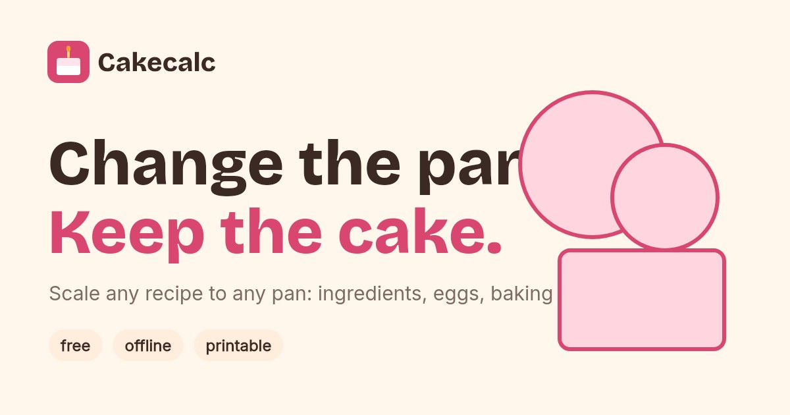
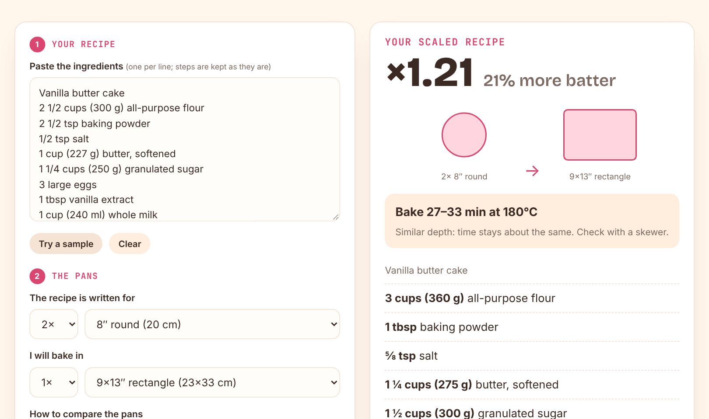

<div align="center">



# Cakecalc

**Change the pan. Keep the cake.**<br>
Paste any recipe, say which pan it was written for and which you own. Every ingredient is scaled, the eggs are sorted out and the baking time is adjusted.

[**Try it live →**](https://cakecalc.vercel.app) · [Report an issue](https://github.com/mskraban/cakecalc/issues)

[](https://github.com/mskraban/cakecalc/actions/workflows/ci.yml)
[](LICENSE)


</div>

---

<p align="center"></p>

## Why

Your recipe says two 8″ round pans and you only own a 9×13″. Guessing gives you a sunken middle or a burnt edge. The rule is simple (compare pan *areas*), but nobody wants to do the maths with a fraction like ⅝ cup in the other hand.

- 📐 **Real pan geometry**: rounds, squares, rectangles, sheets, loaves, bundts, muffin cups, or your own custom pan in cm or inches. Compare by area (same batter depth) or by volume.
- 🧾 **Paste a recipe from anywhere.** Understands `1/2`, `1 1/2`, `1½`, ranges like `2–3`, cups, spoons, grams, ounces, sticks, and keeps parenthesised metric amounts in step.
- 🥚 **Eggs stay whole.** You get the nearest whole egg and how many grams of beaten egg to add or remove.
- 🥄 **Kitchen-friendly rounding.** Fractions to the eighth, `3 tsp → 1 tbsp`, `⅔ tbsp → 2 tsp`, grams to the nearest 5.
- ⚖️ **Optional grams** for cup amounts of 17 common ingredients.
- 🔥 **Oven advice**: same depth keeps the time; deeper batter goes longer and cooler; thinner bakes faster.
- 🖨️ **Print a recipe card** with one click.
- 🔒 **Private and offline.** Nothing leaves your browser. No AI, no tracking, no dependencies.

## Run it

It is a static page:

```bash
git clone https://github.com/mskraban/cakecalc.git
cd cakecalc
npm run dev        # or open public/index.html with any static server
```

## Use the engine in your own project

`public/engine.js` is one file, UMD, with no dependencies.

```js
const C = require('./public/engine.js');
const plan = C.plan({
  from: { pan: C.panById('round-20'), count: 2 },
  to:   { pan: C.panById('rect-23x33'), count: 1 },
  bake: { minutes: 30, temp: 180 },
});
plan.factor;                       // 1.21
C.scaleRecipe('2 1/2 cups flour\n3 large eggs', plan.factor, { grams: true })
  .map((l) => l.line);             // ['3 cups (360 g) flour', '4 large eggs']
```

## How the maths works

- **Factor** = (area of the new pans × count) ÷ (area of the recipe's pans × count). A 9″ round is 1.32× an 8″ round, not 1.12×.
- **Volume mode** multiplies by each pan's capacity instead, for bundts and loaves where depth differs.
- **Oven time** scales with `(batter depth ratio)^0.8` and the oven drops 10–15 °C for batter more than about 1.5× deeper. It is a rule of thumb, not a promise: check with a skewer.

## Contributing

See [CONTRIBUTING.md](CONTRIBUTING.md). New pans and ingredient densities are the easiest first contribution.

## Licence

[MIT](LICENSE). Fonts under the SIL Open Font License, see [NOTICE.md](NOTICE.md).

<p align="center"><sub>Same family: <a href="https://github.com/mskraban/labelmaker">Labelmaker</a> · <a href="https://github.com/mskraban/worldscape">Worldscape</a> · <a href="https://github.com/mskraban/seedscape">Seedscape</a></sub></p>
